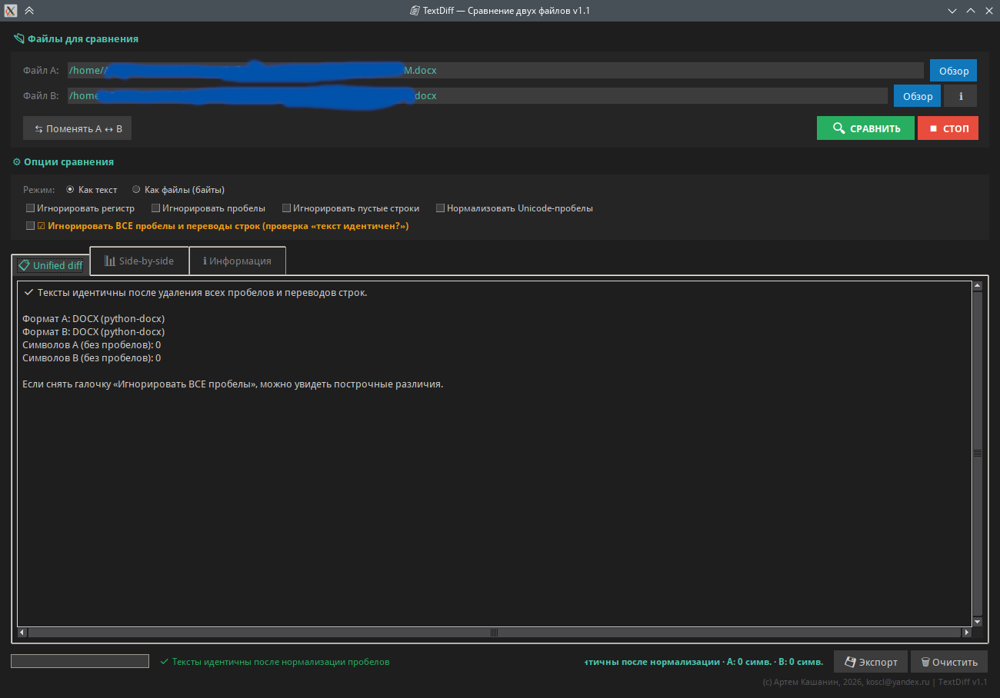

# TEXTDIFF — СРАВНЕНИЕ ДВУХ ФАЙЛОВ
### Версия 1.2

---

## ЧТО ЭТО

---

Утилита сравнивает два файла и показывает различия.
Работает локально, интернет не нужен. Ничего никуда не отправляет.



Два режима:

```
  Как текст
      Извлекает plain text из DOCX / XLSX / PPTX / ODT / PDF /
      TXT / кода и делает построчный diff с подсветкой.

  Как файлы
      Сравнивает байты, показывает SHA-256 и hex-дамп первого
      различия.
```

Две задачи, которые решает утилита:

```
  «Что изменилось между двумя версиями файла?»
      Сравнивает два документа, скрипта, конфига —
      показывает добавленные, удалённые и изменённые строки.

  «Эти файлы точно одинаковые?»
      Сравнивает байты. Если SHA-256 совпал — файлы идентичны.
      Если нет — показывает, с какого байта начинается различие.
```
---

## О ВОЗМОЖНОСТЯХ

---

Три вещи, которые важно понимать сразу.

```
  1. Для офисных документов сравнивается ТЕКСТ,
     не форматирование
      DOCX / XLSX / PPTX / ODT → извлекается plain text →
      сравнивается. Что это значит:

        Видно:      «в новой версии добавился абзац»,
                    «в таблице изменилась цифра»
        НЕ видно:   изменение шрифта, цвета, отступов,
                    размера. Если вы поменяли Arial на Calibri,
                    а текст тот же — diff покажет «файлы идентичны»

      Если нужно сравнить ФОРМАТИРОВАНИЕ — это другая задача,
      требует сравнения XML внутри DOCX.

  2. PDF извлекается не всегда идеально
      pdftotext даёт хороший результат для текстовых PDF.
      Для сканированных (картинки) — ПУСТО. Для PDF с таблицами
      — может «поехать» структура.

      Если PDF не читается — попробуйте байтовый режим:
      он покажет, файлы одинаковые или нет, но не покажет
      различий в тексте.

  3. Бинарный режим показывает ПОЗИЦИИ, не смысл
      Для .exe, .zip, .jpg — утилита не «понимает», что внутри.
      Она скажет: «различие с байта 1247». Hex-дамп покажет,
      какие байты отличаются. Что это значит — решать вам.
```

---

## БЫСТРЫЙ СТАРТ

---

  1. Запустите утилиту.
  2. Выберите Файл A — кнопка «Обзор» ИЛИ перетащите файл
     из проводника прямо в поле «Файл A».
  3. Выберите Файл B — то же самое: кнопка или перетаскивание.
  4. Выберите режим: «Как текст» (по умолчанию) или «Как файлы».
  5. Нажмите «🔍 СРАВНИТЬ».
  6. Посмотрите результат на вкладках Unified diff / Side-by-side /
     Информация.

Кнопка «⇄ Поменять A ↔ B» — если перепутали порядок файлов.

---

## РЕЖИМ «КАК ТЕКСТ»

---

Извлекает текст из обоих файлов и сравнивает построчно.
Поддерживаемые форматы:

```
  Формат                                     Что извлекается
  ─────────────────────────────────────────  ────────────────────────
  TXT, MD, PY, JS, HTML, CSS, JSON, XML,    Прямое чтение
  YAML, INI, LOG, CSV                        (UTF-8, CP1251,
                                             KOI8-R, Latin-1)
  DOCX, DOCM                                 Абзацы через
                                             python-docx или
                                             unzip + XML
  XLSX, XLSM                                 Ячейки через openpyxl
  PPTX, PPTM                                 Текст слайдов через
                                             python-pptx
  ODT, ODS, ODP                              Через unzip + XML
                                             (content.xml)
  PDF                                        Через pdftotext или
                                             PyPDF2
```

Если формат не поддерживается — утилита скажет об этом.
Тогда используйте байтовый режим.

КАК ВЫГЛЯДИТ РЕЗУЛЬТАТ:

```
       1   Первая строка
       2 - Старый текст абзаца
       3 + Новый текст абзаца
       4   Третья строка
          + Добавленная строка
       5 - Удалённая строка

  Пробел в начале   — строка не изменилась
  Минус (−)         — строка была в A, но её нет в B (удалена)
  Плюс (+)          — строка появилась в B, но её не было в A
                      (добавлена)
  Номера строк      — для каждой версии
```

---

## РЕЖИМ «КАК ФАЙЛЫ»

---

Сравнивает БАЙТЫ, а не текст.

```
  Если файлы идентичны:

      ✅ Файлы идентичны (SHA-256 совпал)

      SHA-256: 3f7c...a9b2
      Размер:  2.3 МБ

  Если различаются:

      ❌ Файлы различаются

      SHA-256 A: 3f7c...a9b2
      SHA-256 B: 8e1d...4c03
      Размер A:  2.3 МБ
      Размер B:  2.4 МБ

      Позиция первого различия: 1247 (0x4DF)

          Offset  A                          B
      ──────────  ─────────────────────────  ─────────────────────────
            1232  50 4b 03 04 14 00 00 ...   50 4b 03 04 14 00 00 ...
            1248  3c 00 00 00 4c 00 00 ...   bc 00 00 00 4c 00 00 ...
```

  Когда использовать:
    - Файлы .exe, .zip, .jpg, .mp4 — бинарные
    - Проверить, что файл НЕ подменён (SHA-256 совпал)
    - Файлы большие, а нужно быстро ответить
      «одинаковые или нет»

---

## ОПЦИИ НОРМАЛИЗАЦИИ

---

Применяются только в текстовом режиме.

```
  Игнорировать регистр
      Привет = привет. Полезно для сравнения текстов, где важен
      смысл, а не регистр.

  Игнорировать пробелы
      if (x == 5) = if(x==5). Убирает различия в пробелах
      ВНУТРИ строк. Полезно для кода.

  Игнорировать пустые строки
      Пустые строки и строки из пробелов не учитываются. Полезно,
      когда один редактор добавляет пустые строки, а другой нет.

  Нормализовать Unicode-пробелы
      Неразрывный пробел (U+00A0), узкий (U+2009), тонкий
      (U+200A) → заменяются на обычный. Часто встречается
      в документах из Word и в веб-страницах.
```

---

## ГЛАВНАЯ ГАЛОЧКА — «ИГНОРИРОВАТЬ ВСЕ ПРОБЕЛЫ»

---

```
Отдельная большая галочка ОРАНЖЕВЫМ цветом:

  ☑ Игнорировать ВСЕ пробелы и переводы строк
    (проверка «текст идентичен?»)

ЧТО ДЕЛАЕТ:
  Убирает все пробелы, табы, \r, \n, склеивает всё в одну
  строку и сравнивает.

ЗАЧЕМ:
  Ответить на вопрос «текст тот же, или нет» — НЕЗАВИСИМО
  от форматирования.

ПРИМЕР:

  Файл A:
      Договор
      поставки товаров
      на сумму 100 000 рублей

  Файл B:
      Договор поставки товаров на сумму 100 000 рублей

  Построчный diff покажет 3 различия.
  Галочка «игнорировать все пробелы» → «Тексты идентичны
  после нормализации».

ОБРАТНАЯ СТОРОНА:
  Теряются ГРАНИЦЫ СТРОК. Если в файле B появилось одно слово
  в середине абзаца, утилита скажет «различие есть», но не
  покажет, где именно. Для поиска «где» — снимайте галочку
  и смотрите построчный diff.
```

---

## ВКЛАДКИ РЕЗУЛЬТАТОВ

---

Три вкладки, между ними можно переключаться.

```
  📋 Unified diff
      Один столбец. Строки с + (добавлено) и − (удалено).
      Номера строк для каждой версии. Подсветка: зелёный фон —
      добавлено, красный — удалено.

      Контекст: 3 одинаковые строки вокруг каждого различия,
      остальное сворачивается в «...».

  📊 Side-by-side
      Два столбца рядом: A (слева) и B (справа). Синхронная
      прокрутка. Различия подсвечены. Удобно, когда нужно
      видеть обе версии одновременно.

  ℹ Информация
      - Формат A и B
      - Количество строк
      - SHA-256 обоих файлов
      - Статистика: сколько строк совпало / добавлено /
        удалено / изменено
      - Вердикт: идентичны или различаются
```

---

## ГОРЯЧИЕ КЛАВИШИ И ПЕРЕТАСКИВАНИЕ

---

```
  Enter в поле пути           Начать сравнение
  Двойной ЛКМ по файлу        Выбрать файл в диалоге

  ПЕРЕТАСКИВАНИЕ (Drag-and-Drop)
      Файл из проводника можно перетащить мышкой прямо в поле
      «Файл A» или «Файл B». Поле подсветится зелёным — отпускайте.
      Путь подставится автоматически.

      Работает, если установлена библиотека tkinterdnd2
      (pip install tkinterdnd2). В готовом бинарнике она уже
      зашита — перетаскивание доступно «из коробки».
```

---

## ЭКСПОРТ РЕЗУЛЬТАТОВ

---

```
Кнопка «💾 Экспорт». Форматы:

  HTML    Страница с цветным diff. Открывается в браузере,
          подходит для отправки коллегам.

  TXT     Простой unified-отчёт (только различия, без контекста).

  JSON    Структурированные данные: пути, режим, SHA-256,
          статистика, список строк.

  CSV     Только различия: тип, строка A, строка B, текст A,
          текст B. Разделитель «;», UTF-8 с BOM.
```

---

## НАСТРОЙКИ

---

Настройки сохраняются автоматически при выходе.

```
  Windows:  C:\Users\<Имя>\.textdiff_settings.json
  Linux:    /home/<имя>/.textdiff_settings.json
  macOS:    /Users/<имя>/.textdiff_settings.json
```

Что сохраняется:
  - Пути к последним двум файлам
  - Режим (текст / байты)
  - Все галочки нормализации

Чтобы сбросить настройки — удалите файл.

---

## ТРЕБОВАНИЯ

---


ОС: Windows 7 и новее, Linux, macOS.

